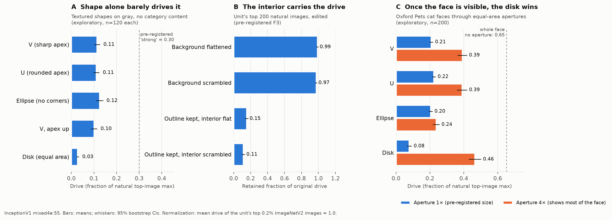

# Is InceptionV1 mixed4e:55 a "V-shape" neuron? Results

Run 2026-10-17, 00:05–00:40 BST, on an Apple M1 Max. Total wall-clock about 35 minutes, of which about 10
were compute. Pre-registration: [PREREGISTRATION.md](PREREGISTRATION.md).
Hashes: [results/prereg.sha256](results/prereg.sha256). Raw numbers:
[results/stage2_tests.json](results/stage2_tests.json). Paths in this report are relative
to the repository root.



## Short version

- **By the pre-registered decision rules, the outcome is "mixed".** None of the four "supported" /
  "refuted" rules fired (details below).
- **Underneath that label, the essay's V account explains little of what drives this unit.**
  - Keeping an object's outline while flattening or scrambling its interior leaves **11–15%** of the drive.
    Swapping the background leaves **97–99%**.
  - Category-free shapes reach at most **~0.12** of the unit's natural maximum.
  - A sharp apex adds nothing over a rounded apex or a corner-free ellipse.
  - A round-faced breed, the **Persian cat, is the unit's #2 ImageNet class**.
  - Pointed objects chosen in advance (missiles, speedboats, guitar picks, spires) sit at the class median.
- **What does hold up:** a small, content-independent preference for elongated over compact outlines
  (~+0.10 of natural max). Also, the essay's own examples (pool table, bullet train) do rank fairly high:
  #32 and #43 of 1,000 classes.
- **Mechanism:** cats and vehicles reach the unit through mostly different mixed4d inputs. Of each group's
  main inputs, only 4d:493 (the essay's "fox snout" channel) is shared. Cats add hamster/fox/tabby
  channels; vehicles add grille and car-front channels, including the essay's own "van front" 4d:201. This
  looks more like **two routes joined by one shared input** than one V mechanism.
- **The one pre-registered result that favored V,** a shape share of 0.70 for cat faces seen through
  apertures, looks like an artifact of the aperture design. The small apertures hid most of the face. With
  4× larger apertures, the disk beats the V on cat faces (0.46 vs 0.39). That check was exploratory and run
  after seeing the result, so weigh it accordingly.

In correlation-vs-causation terms: the essay's evidence is which images *co-occur* with high activation.
When shape and content are manipulated independently, the content accounts for most of the drive.

## Setup (what actually ran)

- **Model:** InceptionV1 with the original Lucid weights (via Lucent). Unit: mixed4e channel 55, in the
  1×1 branch.
- **It's the same unit the essay analyzes.** Its largest input is 4d:493 at 34% of positive drive (the
  essay says 32%), and its strongest 1×1 reader is 5a:94 (the essay's "flames" reader).
- **Data:**
  - ImageNetV2 (10,000 images, 10 per class), standing in for ImageNet val, which needs an account.
  - Oxford-IIIT Pets (images, segmentation trimaps, head boxes).
  - DTD textures.
- **Readout:** post-ReLU spatial max, divided by the mean drive of the unit's top 0.2% of ImageNetV2 images.
  1.0 = typical top natural image.
- **Validity checks:**
  - V0 (unit identity) failed one sub-criterion: 2 vehicles in the top 50, where 3 were required. That's a
    flaw in the pre-registered class list, which left out small mammals. The indexing checks above settled
    the unit's identity, so the study continued (Deviation D1).
  - V1 passed: 98% of mixed4e channels respond strongly (≥ 0.3) to some synthetic stimulus, and the known
    curve detectors reach a median of 0.78 on drawn arcs. The synthetic stimuli are not out of distribution
    for this layer.
- **Stage-1 tuning, frozen before the tests:** apex down, tilted 15° (θ\* = 345°); a wide 120° apex angle
  (α\*); 160 px size (s\*).
- **Deviations:**
  - D1: continued despite the V0 sub-criterion miss.
  - D2: a vehicle fallback rule. It didn't trigger for unit 55, whose top 100 include 16 vehicles.
  - D3: a fix to the shape-share formula, found on a debug unit before unit 55 was run.

  All three are logged in the pre-registration with reasons. The pipeline was debugged on unit 4e:54; the
  unit-55 run reported here is the first and only one.

## Pre-registered primary results

| Test | Result | H_V (essay) | H_face | H_OR (cat ∪ car) |
|---|---|---|---|---|
| **P1** synthetic shapes, neutral texture, no eyes | V 0.12 [0.10, 0.14], U 0.11, disk 0.02. V−disk +0.10 [0.08, 0.12]; V−U +0.01 [−0.01, 0.04] | ✗ needs V ≥ 0.30, V−disk ≥ 0.20, V−U ≥ 0.10 | ✗ V and disk not equivalent (90% CI 0.08–0.11, outside ±0.10) | ✗ same |
| **P2** rank among 832 mixed4e units by V−disk | #65 (top 7.8%); by V−U #168 | ✗ needs top 5% (and θ\* was tuned for this unit) | ✓ | ✓ |
| **P3** shape share σ, apertures | cat faces 0.70 [0.65, 0.75]; vehicles 0.42 [0.37, 0.47] | ✗ needs ≥ 0.67 for both (cats pass, vehicles don't) | ✗ needs ≤ 0.33 | ✗ needs ≤ 0.33 |
| **P4** cat vs vehicle input routes (exact 1×1 decomposition) | overlap relative to ceiling 0.11; vehicle route carries 0.82 of the cat drive, cat route 0.37 of the vehicle drive | ✗ needs overlap ≥ 0.5, both ≥ 0.5 | (needs the shared route) ✗ | ✗ overlap ✓ (≤ 0.2), but 0.82 > 0.25 because 4d:493 sits in both routes |
| **P5** eye-pair effect on a disk | +0.001 [−0.007, 0.009] | ✓ | ✗ needs ≥ 0.15 | ✓ |

The pre-registered decision rules:
- **H_V supported:** no.
- **H_V refuted:** no. It needed σ ≤ 0.33 for cats as well; cats came out at 0.70.
- **H_OR supported:** no. The vehicle route still carries most of the cat drive, through 4d:493.
- **H_face supported:** no.

**Verdict: mixed.**

## Pre-registered secondary results

- **Silhouette vs. interior (F3).** 200 of the unit's top images (100 ImageNetV2 + 100 Pets, none excluded).
  Retained drive:
  - outline kept, interior flat: mean 0.15 [0.13, 0.17], median 0.11;
  - outline kept, interior scrambled: 0.11 [0.10, 0.13], median 0.08;
  - background flattened: 0.99; background scrambled: 0.97.

  H_V predicted ≥ 0.5. That's a clear miss.
- **Within-category shape (F6).**
  - Pets cats: pointed-faced breeds 0.55 vs round 0.61, a difference of −0.07 [−0.11, −0.02]: *opposite*
    to H_V.
  - Pets dogs: pointed 0.35 vs round 0.25, +0.10 [0.07, 0.13]: H_V's direction, but under the +0.15
    threshold.
  - ImageNetV2: +0.05 [−0.02, 0.11], not significant. Siamese minus Persian: −0.37 [−0.58, −0.17].
  - Breed level (post-hoc observation): of the eight dog breeds tested, the flat-faced Japanese chin
    scores highest (0.62). The
    pointed but short-coated miniature pinscher scores 0.13, and the hairless, wedge-headed Sphynx 0.24.
    Coat and face type track the response better than pointedness.
- **Objects outside the hypothesized categories (F7).**
  - Pointed objects chosen in advance: 0.17 vs round 0.14, a difference of +0.03 [−0.01, 0.06], not
    significant. The all-class median is 0.14.
  - Round classes do run slightly more negative before the ReLU (−14.9 vs a median of −11.9), but it's
    inconsistent: tennis balls +33, guitar picks −33.
  - The essay's examples: pool table #32, bullet train #43, fireboat #489.
- **Top 20 classes:** lynx, Persian cat, weasel, papillon, lesser panda, red fox, tabby, grille, hamster,
  Arctic fox, beach wagon, kit fox, sports car, jeep, Japanese spaniel, cab, Pembroke, convertible, Egyptian
  cat, black-footed ferret. That's small furry faces plus car fronts.

## Exploratory checks (run after seeing the results; not part of the verdict)

- **Elongation, not pointedness.** An equal-area ellipse with no corners drives the unit at 0.125, vs 0.113
  for the V (V−ellipse −0.01 [−0.03, 0.01]). Flipping the V's apex upward changes nothing (0.10).
- **Larger apertures.** At 4× area, enough to show most of the face:
  - cat faces: disk 0.46 > V 0.39 ≈ U 0.39 > ellipse 0.24;
  - top animal images: disk 0.76 > V 0.64;
  - vehicles: V ≈ disk (0.53).

  So the 1× shape-share result mostly reflects the aperture outline's weak generic drive, measured while
  the face was hidden.
- **Eyes inside wedges.** From the stage-2 cells: a pair of eyes adds +0.03 to +0.10 *inside wedge shapes*
  (e.g. fur-filled U: 0.12 → 0.21), but nothing inside disks. Not interpreted further.

## Limitations

- One unit in one model.
- All edits are automatic; nothing was hand-annotated.
- In the aperture test, different shapes reveal different parts of the content (equal area, unequal extent).
- "V" was operationalized as a straight-edged wedge, tuned in stage 1. The essay never defines it precisely.
- ImageNetV2 has only 10 images per class.
- Only 2 natural scenes passed the "background doesn't drive the unit" filter, so scene backgrounds have
  little variety.
- The same analyst wrote both the pre-registration and the analysis. The timestamped hashes help, but a
  self-pre-registration is weaker than one held by a third party.

## Follow-up study (run the same day)

Results page with charts, methods and decision tables: [report/index.html](report/index.html) (a static page;
open it in a browser from a local copy of the repository).

**Study 2: 4d:493, the essay's "fox snout" input.** Pre-registration:
[PREREGISTRATION_4d493.md](PREREGISTRATION_4d493.md). Results:
`results_4d493/`.
- **Verdict by the pre-registered rules: pointed-snout account refuted; content account supported.**
- **Shapes alone:** V 0.10, U 0.04, ellipse 0.06, disk 0.02. The sharp apex does beat the rounded U
  (+0.05 [0.03, 0.07]) and the ellipse (+0.04 [0.02, 0.06]), the only real pointedness signal in these
  tests, but it is small.
- **Face-sized windows (disk = face circle):** on cat faces, disk 0.52 > V 0.42 (shape share 0.00). On dog
  faces, V − disk is +0.03 (shape share 0.18).
- **Silhouettes:** outline-only keeps 0.10 (flat) and 0.08 (scrambled).
- **Within category:** round-faced cat breeds slightly above pointed (−0.04 [−0.08, −0.01]).
- **Not run:** the V-silhouette route test was underpowered (only 26 V stimuli reached 0.1), so it's N/A as
  pre-registered.
- **Deviations:** D1, the ellipse is matched to the V's long axis; D2, the U construction was malformed at
  30° and was rebuilt (study 1, at 120°, is unaffected).
- **Runtime** on the M1 Max: about 4 minutes of compute.

## Reproduce

Place the datasets under `scratch/data/` (see the README), then run study 1 from `src/`:

```bash
cd src
for s in s0_scan.py s1_stage1.py "s2_tests.py --unit 55" s3_exploratory.py s4_figure.py; do python -I $s; done
```

The README gives the full script order, including study 2 and the debug runs.

The datasets, Python environment, model weights and cached scans (~4.1 GB in total) are not included in this
repository. Sources: ImageNetV2, Hugging Face `vaishaal/ImageNetV2` (matched-frequency); Oxford-IIIT Pets and
DTD, robots.ox.ac.uk/~vgg/data; InceptionV1 weights, the Lucent default (GitHub
ProGamerGov/pytorch-old-tensorflow-models); Mask R-CNN, download.pytorch.org.

## Files

- `PREREGISTRATION.md`: hypotheses, stimuli, thresholds and decision rules, plus deviations
  D1–D3.
- `src/`: `common.py` (model, hooks, stimuli), `s0_scan.py`, `s1_stage1.py`, `s2_tests.py`,
  `s3_exploratory.py`, `s4_figure.py`. Study 2: `unitprobe.py`, `s5_stage01_4d.py`, `s6_tests_4d.py`.
  The results page `report/index.html` is a static page generated from the JSON results; its build scripts
  are not included.
- `PREREGISTRATION_4d493.md`, `results_4d493/`: study 2. `*_debug492` files are from the pipeline-debug
  run on unit 4d:492.
- `results/`:
  - `stage2_tests.json` (all pre-registered numbers)
  - `exploratory_E1_E2_E3.json`, `stage1_tuning.json`, `v0_unit_identity.json`, `prereg.sha256`
  - figures: `fig_summary.png`, `fig_v0_top24_imagenetv2.jpg`, `fig_stage1_top8_stimuli.jpg`,
    `fig_stage2_examples.jpg`, `fig_F3_examples.jpg`
  - files ending `_debug54` are from the pipeline-debug run on unit 4e:54. They are not part of the reported
    results.
